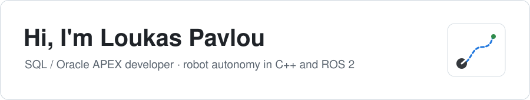

<picture>
  <source media="(prefers-color-scheme: dark)" srcset="assets/header-dark.svg">
  
</picture>

Software developer at **Allianz Greece**, working mainly with **SQL, PL/SQL and Oracle APEX**.
I'm moving into **robotics**: my recent projects are mobile-robot autonomy stacks in **C++** and
**ROS 2**, one with every algorithm written from scratch, one built on the industry stack (Nav2,
Gazebo, behavior trees), both tested in CI and documented down to the bugs I hit.
Before that, Python apps and machine-learning research tools that answer a real question:
*what's worth watching tonight?*, *does this trading idea survive real costs?*

🌐 **[turnedone.github.io](https://turnedone.github.io)** · 💼 [LinkedIn](https://www.linkedin.com/in/luke-pavlou-753104219/) · ✉️ [loukas.pavlou11@gmail.com](mailto:loukas.pavlou11@gmail.com) · 📍 Greece

## 🤖 Robotics

<table>
  <tr>
    <td width="50%" valign="top">
      
      <h3><a href="https://github.com/Turnedone/warehouse-delivery-robot">Warehouse delivery robot</a></h3>
      A TurtleBot 4 takes delivery orders from a queue and drives them from shelves to packing stations
      through a simulated warehouse with keep-out zones, slow zones and a moving forklift, then docks
      to charge when its battery runs low. Built the way a warehouse-automation team would:
      Nav2 (AMCL, MPPI, Smac, costmap filters, docking), a C++ mission layer on BehaviorTree.CPP,
      headless end-to-end tests, a KPI report computed from recorded rosbags.
        
      <code>C++17</code> <code>ROS 2 Jazzy</code> <code>Nav2</code> <code>Gazebo Harmonic</code> <code>BehaviorTree.CPP</code> <code>Docker</code>
    </td>
    <td width="50%" valign="top">
      
      <h3><a href="https://github.com/Turnedone/robot-sim">robot-sim</a></h3>
      A 2D mobile-robot simulator with the autonomy stack written from scratch: differential-drive
      kinematics, a noisy lidar, occupancy-grid mapping, A* and pure pursuit, particle-filter
      localization and GMapping-style SLAM. The same core also drives a TurtleBot 3 in Gazebo
      through ROS 2.
        
      <code>C++17</code> <code>CMake</code> <code>GoogleTest</code> <code>ROS 2</code> <code>raylib</code>
    </td>
  </tr>
</table>

## 🚀 Other projects

<table>
  <tr>
    <td width="50%" valign="top">
      
      <h3><a href="https://turnedone.github.io/flixdex/">Flixdex</a></h3>
      Every Netflix &amp; HBO Max title in your country, with IMDb ratings, in one fast Windows app.
      Search, filters, sorting and one-click <i>Watch</i> links. Uses only free data sources with no daily limits.
        
      <code>Python</code> <code>PySide6 / Qt</code> <code>TMDB</code> <code>IMDb datasets</code>
        
      <a href="https://github.com/Turnedone/flixdex/releases/latest"><b>⬇ Download for Windows</b></a>
    </td>
    <td width="50%" valign="top">
      
      <h3><a href="https://turnedone.github.io/edgelab/">EdgeLab</a></h3>
      Does an intraday machine-learning stock strategy have a real edge after costs? A research system built to
      answer honestly: walk-forward validation, realistic costs, random baselines, Deflated Sharpe and an
      interactive virtual-money dashboard. (So far, the answer is no.)
        
      <code>Python</code> <code>scikit-learn</code> <code>LightGBM</code> <code>pandas</code>
    </td>
  </tr>
</table>

### Also

- **[computational-intelligence](https://github.com/Turnedone/computational-intelligence)**: predicting MovieLens ratings with a neural network and a genetic algorithm. University coursework from 2020, cleaned up, bug-fixed and tested.

## 🧰 Tools I use

**Robotics:**

**Data and apps:**

---

Found a bug or have an idea for one of these? Open an issue on the project. I read them all.
